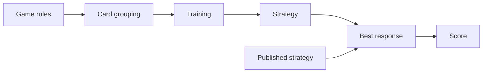

# Rhode Island Hold'em solver

A C++20 program that learns a strategy for Rhode Island Hold'em, a two-player
poker game used in research, and scores it against the strategy Gilpin and
Sandholm published in 2007.

## Results

Chips a perfect opponent wins per hand (exploitability; lower is better, 0 is
perfect):

| Strategy | Exploitability |
|---|---|
| Gilpin and Sandholm | 0.805 |
| This project | 0.094 ± 0.001 |

Averaged over 5 seeds, each about 5½ minutes of training (409.6M iterations)
on a 16-thread laptop. Training runs 10× faster on 16 threads than on one.

The game reproduces the paper's sizes exactly: 6,632,705 deal nodes and
91,224,226 sequence-form LP rows.

## Method



- **Card grouping** merges hands that play identically. The authors' released
  grouping also merges some hands that play differently in the full game, so
  training uses a finer one.
- **Training** is Monte Carlo CFR: self-play that shifts toward actions it
  regrets not taking, on lock-free shared tables.
- **Best response** finds the strongest counter-strategy exactly, in one pass.

## Build and run

Needs CMake 3.20+, a C++20 compiler, curl and unzip. Catch2 is fetched when
CMake configures, and `make test` downloads the published strategy from CMU.

```sh
make test       # build, fetch the published strategy, run the tests
make bench      # training speed and thread scaling
make headline   # the results table, about 30 minutes
.build/release/cfr_measure --train 1600000 run.bin run.log 1 16   # train: seed 1, 16 threads
.build/release/cfr_measure run.bin   # exploitability of a saved strategy
.build/release/cfr_play run.bin      # play against it; no argument plays the published strategy
```

CI runs `make test` with Clang on macOS and GCC on Ubuntu.

MIT license.
